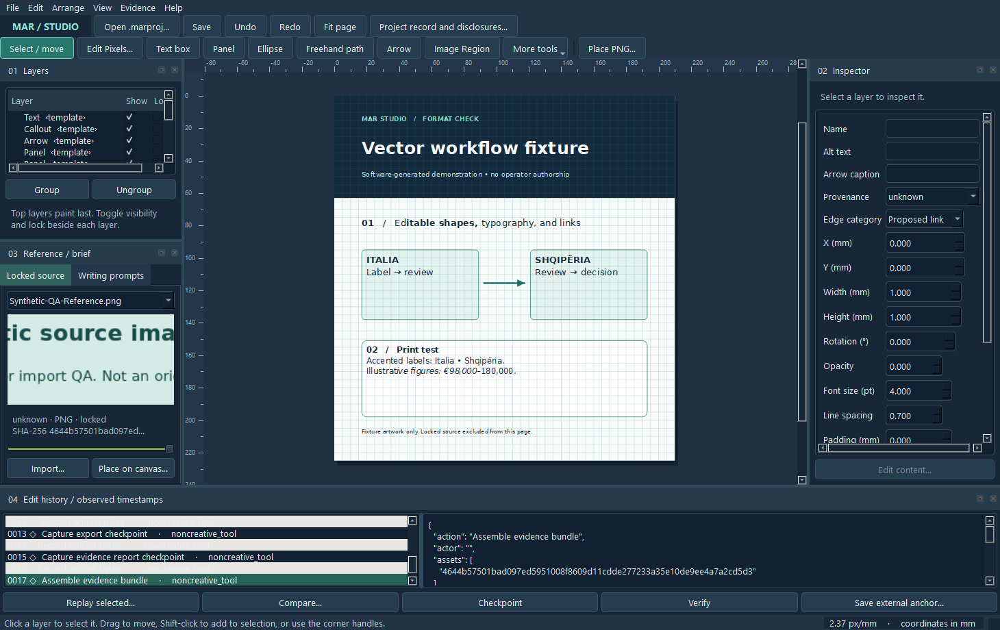

# MAR Studio

MAR Studio is an offline desktop editor for infographics, posters, and annotated diagrams. Build a design on a layered canvas, retouch PNGs in place, and save an editable project with a replayable record of its changes and sources.

A project from [BioThreat Corporation](https://biothreat.com), doing business as [Novus Mercatura Trade Company](https://novusmercatura.com). See the [MAR Studio listing on Novus Mercatura](https://novusmercatura.com/downloads/#mar-studio).



## What you can do

- Draw and edit text, shapes, paths, and linked connectors. Move, resize, rotate, snap, align, group, and reorder layers.
- Select pixels by rectangle, freehand outline, or matching colors. Feather the edges, move the selection on a transparent background, or cut or copy it to a new layer.
- Paste a selection into an existing image layer. Move, resize, rotate, flip, or adjust its opacity before applying it. The paste keeps its transparent edges.
- Paint, erase to transparency, clone pixels, and adjust RGB levels, saturation, blur, and sharpness.
- Keep reference files separate from the artboard. Export editable SVG, printable PDF, 300/600 dpi PNG, or a comparison sheet.
- Replay changes, record source credits and design decisions, and export a printable report or a verifiable evidence bundle.

## AI-assisted work and copyright in the U.S.

A finished graphic can make it hard to tell which parts you created and which came from an AI tool or a third-party source. The U.S. Copyright Office explains that prompts alone generally do not establish authorship of generated output. Original human-written text, creative arrangement, or sufficiently creative modifications may qualify for protection. If a work contains more than a minimal amount of AI-generated material, U.S. registration applicants should disclose that material, exclude it from the claim, and describe their human contribution. See the Office's [copyrightability findings](https://www.copyright.gov/newsnet/2025/1060.html) and [registration guidance](https://www.copyright.gov/ai/ai_policy_guidance.pdf).

MAR Studio addresses the documentation problem. You can keep an AI-generated image as a locked reference, write your own labels and build your own layout on editable layers, and record the source and license of any material you reuse. The project keeps a replayable history of edits and imports. Add your design decisions and AI-use disclosure, then export a report or evidence bundle for review.

The verifier checks the saved record for internal consistency. Copyrightability and ownership depend on the work and the applicable law.

## Install and launch

Download the source ZIP from [Releases](https://github.com/ultros/mar-studio/releases) and extract it, or clone the repository.

```sh
git clone https://github.com/ultros/mar-studio.git
cd mar-studio
```

### Windows 11 x64

Install 64-bit [Python 3.12 or later](https://www.python.org/downloads/windows/) and double-click **startup.bat** in the extracted folder. The launcher creates a local `.venv` on first run and checks the pinned dependencies. If setup is needed, press **I** to install them and launch, or **S** to exit. With a ready environment, the editor opens without downloading anything.

From PowerShell, run these commands individually as needed.

```powershell
.\startup.bat --check         # Check the existing environment
.\startup.bat --install       # Set up the environment and exit
.\startup.bat --skip-install  # Launch only if dependencies are ready
```

Open a specific project with `.\startup.bat "my-poster.marproj"`. To build an unsigned, portable Windows copy, use the [Windows packaging instructions](docs/VALIDATION.md#build-a-windows-executable).

### Linux x86-64

Use Python 3.12 or later, glibc 2.34 or later, and a graphical desktop. Depending on your distribution, Qt may need Fontconfig, GL/EGL, xkbcommon, and the XCB libraries including libxcb-cursor for X11.

```sh
python3 -m venv .venv
.venv/bin/python -m pip install -r requirements.lock
.venv/bin/python run_studio.py
```

The editor works offline once the dependencies are installed.

## Make your first graphic

1. Choose **File → New project** and select **Blank general project**.
2. Choose a tool such as **Text box**, **Panel**, or **Arrow**, then drag on the canvas. Double-click a text layer to edit its wording.
3. Press **V** for **Select / Move**. Drag to move a layer, drag a corner to resize it, or use the handle above it to rotate. **Shift**-click adds a layer to the selection. The inspector accepts exact coordinates.
4. Use **File → Import locked references** to bring in PNG, PDF, Markdown, or plain-text references. Use **Place PNG** to put a reference image on the canvas as an editable layer.
5. Save the editable `.marproj` with **Ctrl+S** and use **File → Export locally** to create a shareable graphic. Enable **Transparent background** under **File → Page size and background** to export a PNG with page transparency.

### Paste a transparent selection into a layer

1. Double-click a placed PNG or choose **Edit Pixels**. Open **Selection**, select an area, and click **Copy Pixels**. **Preview cutout** shows the result against a checkerboard. Use **Copy to New Layer** or **Cut to New Layer** if you want it as a separate canvas layer.
2. Open the destination PNG in **Edit Pixels** and click **Paste into Layer**. Drag the floating selection into place. Use its handles or the **Width**, **Height**, and **Rotation** controls. The destination image bounds clip the paste.
3. Click **Place Selection**, then **Apply to Layer**. The project keeps both the previous and edited bitmap for undo and replay. The pixel workspace supports placed PNG regions up to 20 megapixels.

See the [editing guide](docs/EDITING.md) for selection modes, shortcuts, retouch controls, and pixel editing limits.

## Work with the project history

Use the timeline or **Evidence → Replay history** to review earlier states. In **Evidence → Project record and disclosures**, enter the source credits, decisions, and limitations you have documented. The record uses names entered by the operator and timestamps from the device clock. You can retain a separate copy of the exported anchor for independent comparison. See the [format and verification notes](docs/FORMAT.md).

A native project or evidence bundle can include the original source files, notes, timestamps, and earlier states, including material you later removed from the artboard. Review those files before sharing them. Export a graphic when you only want to share the visible result.

## Run tests and generate examples

Use the Python executable from your environment (`.\.venv\Scripts\python.exe` on Windows or `.venv/bin/python` on Linux) for these commands.

```sh
python -m pip install -r requirements-test.lock
python -m unittest discover -s tests -v
python scripts/make_examples.py
python -m marstudio.integrity output/example-evidence-bundle.zip
```

The examples script generates two blank practice projects under `examples/` and a synthetic evidence bundle under `output/`. See the [validation guide](docs/VALIDATION.md) for platform checks and current limitations.

Use [GitHub Issues](https://github.com/ultros/mar-studio/issues) to report problems. Include your OS, Python version, and steps to reproduce. Use a minimal example you can share publicly.

## License

The project uses the [MIT License](LICENSE). Keep the copyright notice naming `ultros` and MAR Studio contributors and the MIT permission notice in all copies or substantial portions of the software.

The original documentation prose is also available under [CC BY 4.0](https://creativecommons.org/licenses/by/4.0/). Under that option, credit `ultros` and MAR Studio contributors, link to the license, and indicate changes. Bundled fonts and other third-party components retain their own terms. See the [asset and dependency inventory](docs/LICENSES.md).
